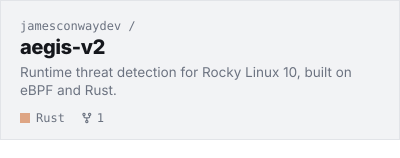
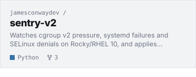
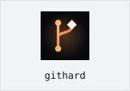

<!--
  Most of this file is hand-written, but not all of it. Everything between the
  STATS, FEATURED, CARDS, REPOS and BLOG markers gets rewritten by
  `python -m scripts.build refresh`, so any edit you make in there will vanish
  on the next run. Change projects.json to swap projects.
-->

<a href="https://jamesconway.dev"><picture><source media="(prefers-color-scheme: dark)" srcset="assets/header-dark.svg"></picture></a>

<a href="https://jamesconway.dev"><picture><source media="(prefers-color-scheme: dark)" srcset="assets/icon-web-dark.svg"></picture></a>
<a href="https://www.linkedin.com/in/jamesjconway/"><picture><source media="(prefers-color-scheme: dark)" srcset="assets/icon-linkedin-dark.svg"></picture></a>
<a href="https://x.com/jamesconway"><picture><source media="(prefers-color-scheme: dark)" srcset="assets/icon-x-dark.svg"></picture></a>
<a href="https://mastodon.social/@jamesconway"><picture><source media="(prefers-color-scheme: dark)" srcset="assets/icon-mastodon-dark.svg"></picture></a>
<a href="https://bsky.app/profile/jamesconway.dev"><picture><source media="(prefers-color-scheme: dark)" srcset="assets/icon-bluesky-dark.svg"></picture></a>

<!-- STATS:START -->

<picture><source media="(prefers-color-scheme: dark)" srcset="assets/stats-dark.svg"></picture>

<!-- STATS:END -->

## Featured Project

<!-- FEATURED:START -->

<a href="https://github.com/conn3xorg/conn3x"><picture><source media="(prefers-color-scheme: dark)" srcset="assets/feature-conn3x-dark.svg"></picture></a>

<code>brew install conn3xorg/tap/conn3x</code> 
<a href="https://conn3x.org">Website</a> · <a href="https://docs.conn3x.org/get-started">Docs</a> · <a href="https://conn3x.org/circuits">Circuits</a> · <a href="https://github.com/conn3xorg/conn3x">GitHub</a>

<!-- FEATURED:END -->

## My Top Open Source Projects

<!-- CARDS:START -->

<picture><source media="(prefers-color-scheme: dark)" srcset="assets/label-high-performance-developer-tools-dark.svg"></picture> 
<a href="https://github.com/netweir/netweir"><picture><source media="(prefers-color-scheme: dark)" srcset="assets/card-netweir-netweir-dark.svg"></picture></a>&emsp;&emsp;<a href="https://github.com/tachyon-cms/tachyoncms"><picture><source media="(prefers-color-scheme: dark)" srcset="assets/card-tachyon-cms-tachyoncms-dark.svg"></picture></a>

 

<picture><source media="(prefers-color-scheme: dark)" srcset="assets/label-linux-infrastructure-dark.svg"></picture> 
<a href="https://github.com/jamesconwaydev/aegis-v2"><picture><source media="(prefers-color-scheme: dark)" srcset="assets/card-jamesconwaydev-aegis-v2-dark.svg"></picture></a>&emsp;&emsp;<a href="https://github.com/jamesconwaydev/sentry-v2"><picture><source media="(prefers-color-scheme: dark)" srcset="assets/card-jamesconwaydev-sentry-v2-dark.svg"></picture></a>

<!-- CARDS:END -->

## Projects I Build and Contribute To

<!-- REPOS:START -->

<a href="https://github.com/conn3xorg"><picture><source media="(prefers-color-scheme: dark)" srcset="assets/repo-conn3xorg-dark.svg"></picture></a>
<a href="https://github.com/netweir"><picture><source media="(prefers-color-scheme: dark)" srcset="assets/repo-netweir-dark.svg"></picture></a>
<a href="https://github.com/tachyon-cms"><picture><source media="(prefers-color-scheme: dark)" srcset="assets/repo-tachyon-cms-dark.svg"></picture></a>
<a href="https://github.com/jamesconwaydev/aegis-v2"><picture><source media="(prefers-color-scheme: dark)" srcset="assets/repo-aegis-v2-dark.svg"></picture></a>
<a href="https://github.com/jamesconwaydev/sentry-v2"><picture><source media="(prefers-color-scheme: dark)" srcset="assets/repo-sentry-v2-dark.svg"></picture></a>
<a href="https://github.com/Sentrello"><picture><source media="(prefers-color-scheme: dark)" srcset="assets/repo-sentrello-dark.svg"></picture></a>
<a href="https://github.com/ticketslinger"><picture><source media="(prefers-color-scheme: dark)" srcset="assets/repo-ticketslinger-dark.svg"></picture></a>
<a href="https://github.com/jamesconwaydev/githard"><picture><source media="(prefers-color-scheme: dark)" srcset="assets/repo-githard-dark.svg"></picture></a>
<a href="https://github.com/jamesconwaydev/blueprints"><picture><source media="(prefers-color-scheme: dark)" srcset="assets/repo-blueprints-dark.svg"></picture></a>
<a href="https://github.com/data-privacy-stack"><picture><source media="(prefers-color-scheme: dark)" srcset="assets/repo-data-privacy-stack-dark.svg"></picture></a>
<a href="https://github.com/mrpinkapps/simple-site"><picture><source media="(prefers-color-scheme: dark)" srcset="assets/repo-simple-site-dark.svg"></picture></a>

<!-- REPOS:END -->

## Latest from Out of Memory

<!-- BLOG:START -->
`2026-10-27` · **[Your Scrapy Spider, Three Lines Later: Moving to Netweir](https://jamesconway.dev/blog/moving-from-scrapy-to-netweir/)** A Scrapy spider moves to Netweir with three lines changed. Here's what carries over, what doesn't yet, and how to try it without leaving Scrapy at all.

`2026-10-25` · **[Two Tools, One Job: Why I Started Building Conn3x](https://jamesconway.dev/blog/why-i-started-conn3x/)** I've started building Conn3x: one Go binary that creates your servers and configures them in the same plan. It's early, and I'm aiming for the CNCF.

`2026-10-23` · **[I Built the Smoke Detector Before the Fire](https://jamesconway.dev/blog/i-built-the-smoke-detector-before-the-fire/)** Aegis v2 is an open-source eBPF tool that watches process behaviour on Rocky Linux 10, adds the warning signs into one score, and records one incident.

[Read the rest on jamesconway.dev →](https://jamesconway.dev/blog/)
<!-- BLOG:END -->

<picture><source media="(prefers-color-scheme: dark)" srcset="assets/footer-dark.svg"></picture>

