<!--
  Most of this file is hand-written, but not all of it. Everything between the
  FEATURED, CARDS, REPOS and BLOG markers gets rewritten by
  `python -m scripts.build refresh`, so any edit you make in there will vanish
  on the next run. Change projects.json to swap projects.
-->

<a href="https://jamesconway.dev"><picture><source media="(prefers-color-scheme: dark)" srcset="assets/header-dark.svg"></picture></a>

<a href="https://jamesconway.dev"><picture><source media="(prefers-color-scheme: dark)" srcset="assets/icon-web-dark.svg"></picture></a>
<a href="https://www.linkedin.com/in/jamesjconway/"><picture><source media="(prefers-color-scheme: dark)" srcset="assets/icon-linkedin-dark.svg"></picture></a>
<a href="https://x.com/jamesconway"><picture><source media="(prefers-color-scheme: dark)" srcset="assets/icon-x-dark.svg"></picture></a>
<a href="https://mastodon.social/@jamesconway"><picture><source media="(prefers-color-scheme: dark)" srcset="assets/icon-mastodon-dark.svg"></picture></a>
<a href="https://bsky.app/profile/jamesconway.dev"><picture><source media="(prefers-color-scheme: dark)" srcset="assets/icon-bluesky-dark.svg"></picture></a>

## Featured Project

<!-- FEATURED:START -->

<a href="https://github.com/conn3xorg/conn3x"><picture><source media="(prefers-color-scheme: dark)" srcset="assets/feature-conn3x-dark.svg"></picture></a>

<code>brew install conn3xorg/tap/conn3x</code> 
<a href="https://conn3x.org">Website</a> · <a href="https://docs.conn3x.org/get-started">Docs</a> · <a href="https://conn3x.org/circuits">Circuits</a> · <a href="https://github.com/conn3xorg/conn3x">GitHub</a> · <a href="https://www.youtube.com/@conn3xlabs">YouTube</a>

<!-- FEATURED:END -->

## Other Cool Projects

<!-- CARDS:START -->

<a href="https://github.com/netweir/netweir"><picture><source media="(prefers-color-scheme: dark)" srcset="assets/card-netweir-netweir-dark.svg">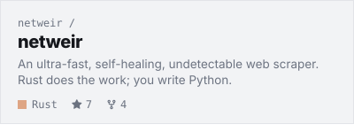</picture></a>&emsp;&emsp;<a href="https://github.com/tachyon-cms/tachyoncms"><picture><source media="(prefers-color-scheme: dark)" srcset="assets/card-tachyon-cms-tachyoncms-dark.svg">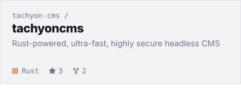</picture></a>

 

<a href="https://github.com/getgithard/githard"><picture><source media="(prefers-color-scheme: dark)" srcset="assets/card-getgithard-githard-dark.svg">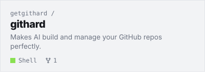</picture></a>&emsp;&emsp;<a href="https://github.com/devstreamhq/devstream"><picture><source media="(prefers-color-scheme: dark)" srcset="assets/card-devstreamhq-devstream-dark.svg">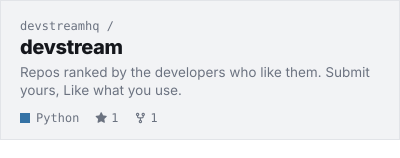</picture></a>

<!-- CARDS:END -->

## Projects I Build and Contribute To

<!-- REPOS:START -->

<a href="https://github.com/conn3xorg"><picture><source media="(prefers-color-scheme: dark)" srcset="assets/repo-conn3xorg-dark.svg">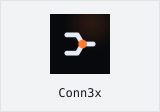</picture></a>
<a href="https://github.com/netweir"><picture><source media="(prefers-color-scheme: dark)" srcset="assets/repo-netweir-dark.svg">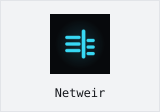</picture></a>
<a href="https://github.com/tachyon-cms"><picture><source media="(prefers-color-scheme: dark)" srcset="assets/repo-tachyon-cms-dark.svg">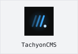</picture></a>
<a href="https://github.com/jamesconwaydev/aegis-v2"><picture><source media="(prefers-color-scheme: dark)" srcset="assets/repo-aegis-v2-dark.svg">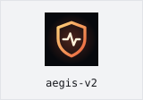</picture></a>
<a href="https://github.com/jamesconwaydev/sentry-v2"><picture><source media="(prefers-color-scheme: dark)" srcset="assets/repo-sentry-v2-dark.svg">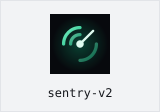</picture></a>
<a href="https://github.com/Sentrello"><picture><source media="(prefers-color-scheme: dark)" srcset="assets/repo-sentrello-dark.svg">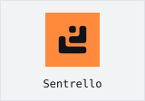</picture></a>
<a href="https://github.com/ticketslinger"><picture><source media="(prefers-color-scheme: dark)" srcset="assets/repo-ticketslinger-dark.svg">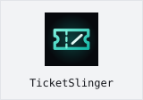</picture></a>
<a href="https://github.com/jamesconwaydev/blueprints"><picture><source media="(prefers-color-scheme: dark)" srcset="assets/repo-blueprints-dark.svg">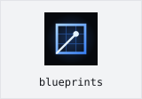</picture></a>
<a href="https://github.com/prometheus"><picture><source media="(prefers-color-scheme: dark)" srcset="assets/repo-prometheus-dark.svg"></picture></a>
<a href="https://github.com/tailscale"><picture><source media="(prefers-color-scheme: dark)" srcset="assets/repo-tailscale-dark.svg">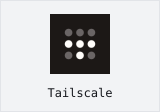</picture></a>
<a href="https://github.com/cockpit-project"><picture><source media="(prefers-color-scheme: dark)" srcset="assets/repo-cockpit-project-dark.svg">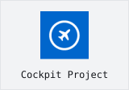</picture></a>
<a href="https://github.com/data-privacy-stack"><picture><source media="(prefers-color-scheme: dark)" srcset="assets/repo-data-privacy-stack-dark.svg"></picture></a>
<a href="https://github.com/up-for-grabs"><picture><source media="(prefers-color-scheme: dark)" srcset="assets/repo-up-for-grabs-dark.svg"></picture></a>
<a href="https://github.com/github"><picture><source media="(prefers-color-scheme: dark)" srcset="assets/repo-github-dark.svg">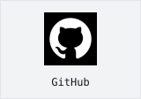</picture></a>
<a href="https://github.com/n8n-io"><picture><source media="(prefers-color-scheme: dark)" srcset="assets/repo-n8n-io-dark.svg">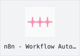</picture></a>
<a href="https://github.com/jenkins-infra"><picture><source media="(prefers-color-scheme: dark)" srcset="assets/repo-jenkins-infra-dark.svg">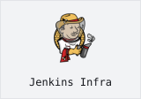</picture></a>
<a href="https://github.com/jenkinsci"><picture><source media="(prefers-color-scheme: dark)" srcset="assets/repo-jenkinsci-dark.svg">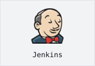</picture></a>
<a href="https://github.com/devstreamhq"><picture><source media="(prefers-color-scheme: dark)" srcset="assets/repo-devstreamhq-dark.svg">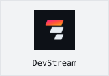</picture></a>
<a href="https://github.com/parsec-html"><picture><source media="(prefers-color-scheme: dark)" srcset="assets/repo-parsec-html-dark.svg">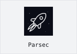</picture></a>
<a href="https://github.com/jamesconwaydev/advisory-database"><picture><source media="(prefers-color-scheme: dark)" srcset="assets/repo-advisory-database-dark.svg">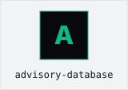</picture></a>
<a href="https://github.com/jamesconwaydev/cockpit"><picture><source media="(prefers-color-scheme: dark)" srcset="assets/repo-cockpit-dark.svg">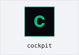</picture></a>
<a href="https://github.com/getgithard"><picture><source media="(prefers-color-scheme: dark)" srcset="assets/repo-getgithard-dark.svg">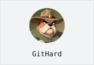</picture></a>
<a href="https://github.com/keyparity"><picture><source media="(prefers-color-scheme: dark)" srcset="assets/repo-keyparity-dark.svg">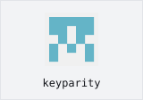</picture></a>
<a href="https://github.com/mrpinkapps/simple-site"><picture><source media="(prefers-color-scheme: dark)" srcset="assets/repo-simple-site-dark.svg">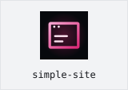</picture></a>
<a href="https://github.com/jamesconwaydev/up-for-grabs.net"><picture><source media="(prefers-color-scheme: dark)" srcset="assets/repo-up-for-grabs.net-dark.svg"></picture></a>

<!-- REPOS:END -->

## Latest from Out of Memory

<!-- BLOG:START -->
`2026-11-03` · **[A Private AI Box for 4 Cents an Hour](https://jamesconway.dev/blog/private-ai-box/)** I wanted to ask questions of my own notes without pasting them into someone else's chatbot. One Conn3x apply now builds the box for it, and the only door it leaves open is SSH.

`2026-11-02` · **[I Found Out About Hacktoberfest Two Days Late](https://jamesconway.dev/blog/hacktoberfest-2026-recap/)** Hacktoberfest ended on 31 October. I found out it existed on 2 November. Here's the October I had anyway: two launches, nine new contributors, and a lot of me talking to myself.

`2026-10-27` · **[Your Scrapy Spider, Three Lines Later: Moving to Netweir](https://jamesconway.dev/blog/moving-from-scrapy-to-netweir/)** A Scrapy spider moves to Netweir with three lines changed. Here's what carries over, what doesn't yet, and how to try it without leaving Scrapy at all.

[Read the rest on jamesconway.dev →](https://jamesconway.dev/blog/)
<!-- BLOG:END -->

<picture><source media="(prefers-color-scheme: dark)" srcset="assets/footer-dark.svg"></picture>

