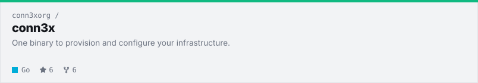

<!--
  Most of this file is hand-written, but not all of it. The project cards
  between the FEATURED and CARDS markers, and the posts between the BLOG
  markers, get rewritten by `python -m scripts.build refresh`, so any edit
  you make in there will vanish on the next run. Change projects.json to swap projects.
-->

<a href="https://jamesconway.dev"><picture><source media="(prefers-color-scheme: dark)" srcset="assets/header-dark.svg"></picture></a>

<a href="https://jamesconway.dev"><picture><source media="(prefers-color-scheme: dark)" srcset="assets/icon-web-dark.svg"></picture></a>
<a href="https://www.linkedin.com/in/jamesjconway/"><picture><source media="(prefers-color-scheme: dark)" srcset="assets/icon-linkedin-dark.svg"></picture></a>
<a href="https://x.com/jamesconway"><picture><source media="(prefers-color-scheme: dark)" srcset="assets/icon-x-dark.svg"></picture></a>
<a href="https://mastodon.social/@jamesconway"><picture><source media="(prefers-color-scheme: dark)" srcset="assets/icon-mastodon-dark.svg"></picture></a>
<a href="https://bsky.app/profile/jamesconway.dev"><picture><source media="(prefers-color-scheme: dark)" srcset="assets/icon-bluesky-dark.svg"></picture></a>

<picture><source media="(prefers-color-scheme: dark)" srcset="assets/follow-dark.svg"></picture>

## Featured Project

<!-- FEATURED:START -->

<a href="https://github.com/conn3xorg/conn3x"><picture><source media="(prefers-color-scheme: dark)" srcset="assets/card-conn3xorg-conn3x-featured-dark.svg"></picture></a>

<!-- FEATURED:END -->

## My Top Open Source Projects

<!-- CARDS:START -->

<picture><source media="(prefers-color-scheme: dark)" srcset="assets/label-high-performance-developer-tools-dark.svg"></picture> 
<a href="https://github.com/netweir/netweir"><picture><source media="(prefers-color-scheme: dark)" srcset="assets/card-netweir-netweir-dark.svg"></picture></a>
<a href="https://github.com/tachyon-cms/tachyoncms"><picture><source media="(prefers-color-scheme: dark)" srcset="assets/card-tachyon-cms-tachyoncms-dark.svg"></picture></a>

<picture><source media="(prefers-color-scheme: dark)" srcset="assets/label-linux-infrastructure-dark.svg"></picture> 
<a href="https://github.com/jamesconwaydev/aegis-v2"><picture><source media="(prefers-color-scheme: dark)" srcset="assets/card-jamesconwaydev-aegis-v2-dark.svg"></picture></a>
<a href="https://github.com/jamesconwaydev/sentry-v2"><picture><source media="(prefers-color-scheme: dark)" srcset="assets/card-jamesconwaydev-sentry-v2-dark.svg"></picture></a>

<picture><source media="(prefers-color-scheme: dark)" srcset="assets/label-self-hosted-business-software-dark.svg"></picture> 
<a href="https://github.com/Sentrello/Sentrello"><picture><source media="(prefers-color-scheme: dark)" srcset="assets/card-sentrello-sentrello-dark.svg"></picture></a>
<a href="https://github.com/ticketslinger/ticketslinger"><picture><source media="(prefers-color-scheme: dark)" srcset="assets/card-ticketslinger-ticketslinger-dark.svg"></picture></a>

<!-- CARDS:END -->

## Latest from Out of Memory

<!-- BLOG:START -->
`2026-10-25` · **[Two Tools, One Job: Why I Started Building Conn3x](https://jamesconway.dev/blog/why-i-started-conn3x/)** I've started building Conn3x: one Go binary that creates your servers and configures them in the same plan. It's early, and I'm aiming for the CNCF.

`2026-10-23` · **[I Built the Smoke Detector Before the Fire](https://jamesconway.dev/blog/i-built-the-smoke-detector-before-the-fire/)** Aegis v2 is an open-source eBPF tool that watches process behaviour on Rocky Linux 10, adds the warning signs into one score, and records one incident.

`2026-10-10` · **[Apparently, I Don't Know How to Build Small Projects](https://jamesconway.dev/blog/apparently-i-dont-know-how-to-build-small-projects/)** Sentrello wasn't enough, so I built NetWeir: a Rust-core, Python-API web scraper, days old and public on GitHub. One more project still to come.

[Read the rest on jamesconway.dev →](https://jamesconway.dev/blog/)
<!-- BLOG:END -->

<picture><source media="(prefers-color-scheme: dark)" srcset="assets/footer-dark.svg"></picture>

