<!--
  Most of this file is hand-written, but not all of it. Everything between the
  FEATURED, REPOS and BLOG markers gets rewritten by
  `python -m scripts.build refresh`, so any edit you make in there will vanish
  on the next run. To bring project cards back, add groups to projects.json
  and a CARDS block.
-->

<a href="https://jamesconway.dev"><picture><source media="(prefers-color-scheme: dark)" srcset="assets/header-dark.svg"></picture></a>

<a href="https://jamesconway.dev"><picture><source media="(prefers-color-scheme: dark)" srcset="assets/icon-web-dark.svg"></picture></a>
<a href="https://www.linkedin.com/in/jamesjconway/"><picture><source media="(prefers-color-scheme: dark)" srcset="assets/icon-linkedin-dark.svg"></picture></a>
<a href="https://x.com/jamesconway"><picture><source media="(prefers-color-scheme: dark)" srcset="assets/icon-x-dark.svg">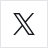</picture></a>
<a href="https://mastodon.social/@jamesconway"><picture><source media="(prefers-color-scheme: dark)" srcset="assets/icon-mastodon-dark.svg"></picture></a>
<a href="https://bsky.app/profile/jamesconway.dev"><picture><source media="(prefers-color-scheme: dark)" srcset="assets/icon-bluesky-dark.svg"></picture></a>

## Featured Project

<!-- FEATURED:START -->

<a href="https://github.com/conn3xorg/conn3x"><picture><source media="(prefers-color-scheme: dark)" srcset="assets/feature-conn3x-dark.svg"></picture></a>

<code>brew install conn3xorg/tap/conn3x</code> 
<a href="https://conn3x.org">Website</a> · <a href="https://docs.conn3x.org/get-started">Docs</a> · <a href="https://conn3x.org/circuits">Circuits</a> · <a href="https://github.com/conn3xorg/conn3x">GitHub</a> · <a href="https://www.youtube.com/@conn3xlabs">YouTube</a>

<!-- FEATURED:END -->

## Other Projects I Build and Contribute To

<!-- REPOS:START -->

<a href="https://github.com/conn3xorg"><picture><source media="(prefers-color-scheme: dark)" srcset="assets/repo-conn3xorg-dark.svg">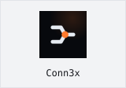</picture></a>
<a href="https://github.com/netweir"><picture><source media="(prefers-color-scheme: dark)" srcset="assets/repo-netweir-dark.svg">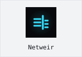</picture></a>
<a href="https://github.com/tachyon-cms"><picture><source media="(prefers-color-scheme: dark)" srcset="assets/repo-tachyon-cms-dark.svg">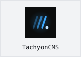</picture></a>
<a href="https://github.com/jamesconwaydev/aegis-v2"><picture><source media="(prefers-color-scheme: dark)" srcset="assets/repo-aegis-v2-dark.svg">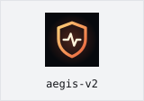</picture></a>
<a href="https://github.com/jamesconwaydev/sentry-v2"><picture><source media="(prefers-color-scheme: dark)" srcset="assets/repo-sentry-v2-dark.svg">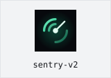</picture></a>
<a href="https://github.com/Sentrello"><picture><source media="(prefers-color-scheme: dark)" srcset="assets/repo-sentrello-dark.svg">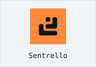</picture></a>
<a href="https://github.com/ticketslinger"><picture><source media="(prefers-color-scheme: dark)" srcset="assets/repo-ticketslinger-dark.svg">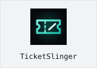</picture></a>
<a href="https://github.com/prometheus"><picture><source media="(prefers-color-scheme: dark)" srcset="assets/repo-prometheus-dark.svg">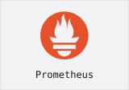</picture></a>
<a href="https://github.com/withastro"><picture><source media="(prefers-color-scheme: dark)" srcset="assets/repo-withastro-dark.svg">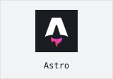</picture></a>
<a href="https://github.com/BerriAI"><picture><source media="(prefers-color-scheme: dark)" srcset="assets/repo-berriai-dark.svg">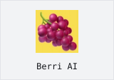</picture></a>
<a href="https://github.com/aquasecurity"><picture><source media="(prefers-color-scheme: dark)" srcset="assets/repo-aquasecurity-dark.svg">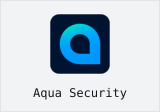</picture></a>
<a href="https://github.com/tailscale"><picture><source media="(prefers-color-scheme: dark)" srcset="assets/repo-tailscale-dark.svg">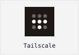</picture></a>
<a href="https://github.com/keycloak"><picture><source media="(prefers-color-scheme: dark)" srcset="assets/repo-keycloak-dark.svg">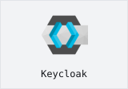</picture></a>
<a href="https://github.com/Infisical"><picture><source media="(prefers-color-scheme: dark)" srcset="assets/repo-infisical-dark.svg">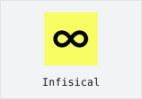</picture></a>
<a href="https://github.com/osquery"><picture><source media="(prefers-color-scheme: dark)" srcset="assets/repo-osquery-dark.svg">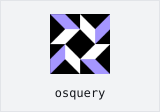</picture></a>
<a href="https://github.com/cockpit-project"><picture><source media="(prefers-color-scheme: dark)" srcset="assets/repo-cockpit-project-dark.svg">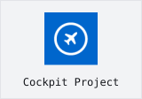</picture></a>
<a href="https://github.com/data-privacy-stack"><picture><source media="(prefers-color-scheme: dark)" srcset="assets/repo-data-privacy-stack-dark.svg">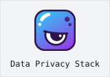</picture></a>
<a href="https://github.com/microsoft"><picture><source media="(prefers-color-scheme: dark)" srcset="assets/repo-microsoft-dark.svg"></picture></a>
<a href="https://github.com/up-for-grabs"><picture><source media="(prefers-color-scheme: dark)" srcset="assets/repo-up-for-grabs-dark.svg"></picture></a>
<a href="https://github.com/github"><picture><source media="(prefers-color-scheme: dark)" srcset="assets/repo-github-dark.svg">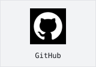</picture></a>
<a href="https://github.com/n8n-io"><picture><source media="(prefers-color-scheme: dark)" srcset="assets/repo-n8n-io-dark.svg">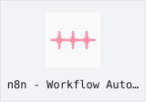</picture></a>
<a href="https://github.com/OpenSCAP"><picture><source media="(prefers-color-scheme: dark)" srcset="assets/repo-openscap-dark.svg">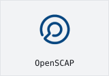</picture></a>
<a href="https://github.com/linux-audit"><picture><source media="(prefers-color-scheme: dark)" srcset="assets/repo-linux-audit-dark.svg">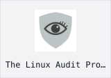</picture></a>
<a href="https://github.com/jenkins-infra"><picture><source media="(prefers-color-scheme: dark)" srcset="assets/repo-jenkins-infra-dark.svg">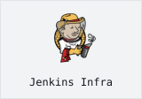</picture></a>
<a href="https://github.com/jenkinsci"><picture><source media="(prefers-color-scheme: dark)" srcset="assets/repo-jenkinsci-dark.svg">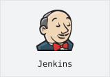</picture></a>
<a href="https://github.com/parsec-html"><picture><source media="(prefers-color-scheme: dark)" srcset="assets/repo-parsec-html-dark.svg">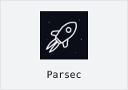</picture></a>
<a href="https://github.com/devstreamhq"><picture><source media="(prefers-color-scheme: dark)" srcset="assets/repo-devstreamhq-dark.svg">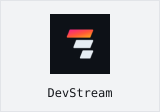</picture></a>
<a href="https://github.com/getgithard"><picture><source media="(prefers-color-scheme: dark)" srcset="assets/repo-getgithard-dark.svg">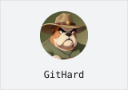</picture></a>
<a href="https://github.com/jamesconwaydev/advisory-database"><picture><source media="(prefers-color-scheme: dark)" srcset="assets/repo-advisory-database-dark.svg">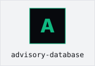</picture></a>
<a href="https://github.com/jamesconwaydev/cockpit"><picture><source media="(prefers-color-scheme: dark)" srcset="assets/repo-cockpit-dark.svg">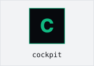</picture></a>
<a href="https://github.com/jamesconwaydev/up-for-grabs.net"><picture><source media="(prefers-color-scheme: dark)" srcset="assets/repo-up-for-grabs.net-dark.svg"></picture></a>
<a href="https://github.com/jamesconwaydev/winget-pkgs"><picture><source media="(prefers-color-scheme: dark)" srcset="assets/repo-winget-pkgs-dark.svg">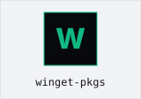</picture></a>

<!-- REPOS:END -->

## Latest from Out of Memory

<!-- BLOG:START -->
`2026-11-25` · **[Private Chat That Stays Private](https://jamesconway.dev/blog/private-chat-that-stays-private/)** Your team is already pasting work into personal chatbot accounts. One Conn3x apply gives them Open WebUI on a box you control, and every door starts shut.

`2026-11-22` · **[Parsec: 16 Days to Beat Lexbor, and What I'm Building Next](https://jamesconway.dev/blog/parsec-from-html-parser-to-parsing-toolkit/)** Parsec started as the HTML parser Netweir needed. It beat Lexbor on every page in the benchmark, and on every input built to break it. Now it's becoming the parsing foundation for the web I wish I'd had from the start.

`2026-11-18` · **[One Gateway for Every Model, and a Key for Everyone](https://jamesconway.dev/blog/one-gateway-for-every-model/)** Your OpenAI key is in four .env files and a Slack thread. One Conn3x apply puts a gateway in front of every model and gives each person their own key.

[Read the rest on jamesconway.dev →](https://jamesconway.dev/blog/)
<!-- BLOG:END -->

<picture><source media="(prefers-color-scheme: dark)" srcset="assets/footer-dark.svg"></picture>

