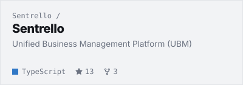
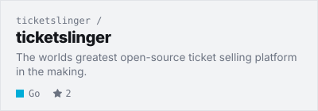
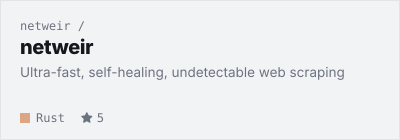
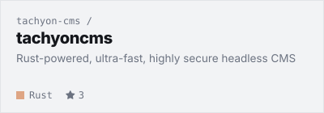
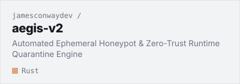
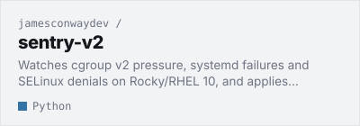

<!--
  Most of this file is hand-written, but not all of it. The project cards
  between the CARDS markers and the posts between the BLOG markers get
  rewritten by `python -m scripts.build refresh`, so any edit you make in
  there will vanish on the next run. Change projects.json to swap projects.
-->

<a href="https://jamesconway.dev"><picture><source media="(prefers-color-scheme: dark)" srcset="assets/header-dark.svg"></picture></a>

<a href="https://jamesconway.dev"><picture><source media="(prefers-color-scheme: dark)" srcset="assets/icon-web-dark.svg"></picture></a>
<a href="https://www.linkedin.com/in/jamesjconway/"><picture><source media="(prefers-color-scheme: dark)" srcset="assets/icon-linkedin-dark.svg"></picture></a>
<a href="https://x.com/jamesconway"><picture><source media="(prefers-color-scheme: dark)" srcset="assets/icon-x-dark.svg"></picture></a>

<a href="https://github.com/jamesconwaydev"><picture><source media="(prefers-color-scheme: dark)" srcset="assets/button-follow-dark.svg"></picture></a>
<a href="#my-top-open-source-projects"><picture><source media="(prefers-color-scheme: dark)" srcset="assets/button-star-dark.svg"></picture></a>

## My Top Open Source Projects

<!-- CARDS:START -->

<picture><source media="(prefers-color-scheme: dark)" srcset="assets/label-self-hosted-business-software-dark.svg"></picture> 
<a href="https://github.com/Sentrello/Sentrello"><picture><source media="(prefers-color-scheme: dark)" srcset="assets/card-sentrello-sentrello-dark.svg"></picture></a>
<a href="https://github.com/ticketslinger/ticketslinger"><picture><source media="(prefers-color-scheme: dark)" srcset="assets/card-ticketslinger-ticketslinger-dark.svg"></picture></a>

<picture><source media="(prefers-color-scheme: dark)" srcset="assets/label-high-performance-developer-tools-dark.svg"></picture> 
<a href="https://github.com/netweir/netweir"><picture><source media="(prefers-color-scheme: dark)" srcset="assets/card-netweir-netweir-dark.svg"></picture></a>
<a href="https://github.com/tachyon-cms/tachyoncms"><picture><source media="(prefers-color-scheme: dark)" srcset="assets/card-tachyon-cms-tachyoncms-dark.svg"></picture></a>

<picture><source media="(prefers-color-scheme: dark)" srcset="assets/label-linux-infrastructure-dark.svg"></picture> 
<a href="https://github.com/jamesconwaydev/aegis-v2"><picture><source media="(prefers-color-scheme: dark)" srcset="assets/card-jamesconwaydev-aegis-v2-dark.svg"></picture></a>
<a href="https://github.com/jamesconwaydev/sentry-v2"><picture><source media="(prefers-color-scheme: dark)" srcset="assets/card-jamesconwaydev-sentry-v2-dark.svg"></picture></a>

<!-- CARDS:END -->

## Latest from Out of Memory

<!-- BLOG:START -->
`2026-10-10` · **[Apparently, I Don't Know How to Build Small Projects](https://jamesconway.dev/blog/apparently-i-dont-know-how-to-build-small-projects/)** Sentrello wasn't enough, so I built NetWeir: a Rust-core, Python-API web scraper, days old and public on GitHub. One more project still to come.

`2026-10-05` · **[I'm the Worst at Creative Writing](https://jamesconway.dev/blog/im-the-worst-at-creative-writing/)** Twenty-eight years in IT, not one blog post. Then May happened: a layoff, an open-source platform called Sentrello, and a reason to start writing.

`2026-06-26` · **[Astro 7 Starter Theme: Production-Ready Blueprint (Tailwind 4 + Full SEO)](https://jamesconway.dev/blog/astro-7-starter-theme/)** A copy-paste Astro 7 + Tailwind 4 starter theme with full JSON-LD SEO, RSS, sitemap, oklch design tokens, and a custom 404.

[Read the rest on jamesconway.dev →](https://jamesconway.dev/blog/)
<!-- BLOG:END -->

<picture><source media="(prefers-color-scheme: dark)" srcset="assets/footer-dark.svg"></picture>

